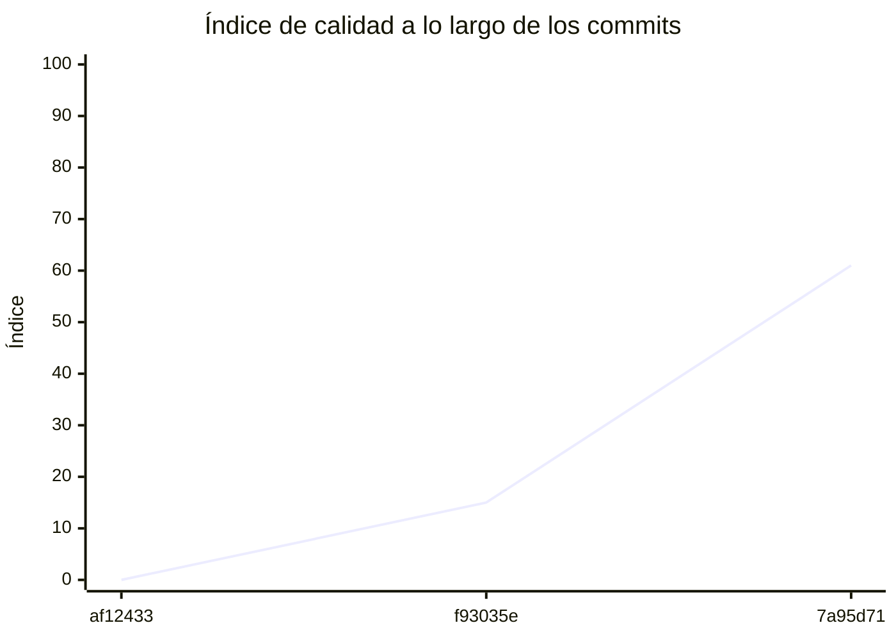

<!-- evaluacion:inicio -->
# Evaluación — manudiiez-um-programacion/turnos-reservas-service

> Documento **generado automáticamente** por la cátedra de Programación II (UM): RepoSense + análisis de calidad de **7 dimensiones**. **No editar a mano**: se regenera en cada evaluación.
> Rama evaluada: `main`. Análisis **heurístico** (regex + métricas) + build: es una criba para orientar la revisión, **no una nota**. La **documentación** del repositorio no se evalúa.
> Generado: 2026-11-11.

## 1. Veredicto

| Aspecto | Resultado |
|---|---|
| Índice de calidad | **72/100** |
| Tipo de repositorio | `backend` |
| Build (`mvnw verify` / `gradlew check`) | OK |
| Código (LOC) | 3,403 |
| Archivos de código | 73 |
| Clases | 93 |
| Código dentro de clases (%POO) | 74% |
| Funciones fuera de clases | 0 |
| Duplicación (puerta) | 3.7% |
| Duplicación lógica | 4.0% |
| Duplicación de boilerplate | 9.6% |
| Cobertura | 98% |
| Tope duro aplicado a D1 | `POO_BAJO` → D1 ≤ 60 |

> Este informe **describe** lo que el análisis midió con los criterios ya establecidos de la materia. No es una nota.

## 2. Semáforo de aprobación

Criterios de la cátedra (`CRITERIOS-CALIDAD.md`): **Aprobar** se juega con el perfil `estandar`; **destacar**, con el `exigente` (meta de excelencia).

| Semáforo | Resultado |
|---|---|
| Aprobar (`estandar`) | **no cumple** — 7/11 |
| Destacar (`exigente`) | **no cumple** — 5/11 |

**Para aprobar, falta cumplir:** Duplicación

**Para destacar, falta cumplir:** SOLID; POO; Duplicación

## 3. Autoría (RepoSense)

| Autor | Commits | Código (LOC) | Tests (LOC) | Docs (LOC) | Días activos | % del código |
|---|---:|---:|---:|---:|---:|---:|
| Manuel Diez de Oñate | 24 | 2,751 | 2,263 | 3,220 | 5 | 100% |

> _El LOC de autoría lo calcula RepoSense sobre el historial y puede diferir del LOC de código del análisis (que mira el estado de `main`)._

## 4. Dimensiones evaluadas

Cada dimensión indica **qué mide**, **por qué importa** y **tu resultado**. Cuando el puntaje queda por debajo de la referencia, se agregan preguntas para **investigar la causa** (no hay recetas).

| Dimensión | Peso | Puntaje |
|:--|--:|--:|
| **D1** Diseño OO, SOLID y patrones (20%) | 20% | 6 |
| **D2** Arquitectura hexagonal — backend (15%) | 15% | 100 |
| **D3** Frontend KMP: MVVM y buenas prácticas (10%) | 10% | N/A |
| **D4** Integración y contrato (10%) | 10% | 40 |
| **D5** Seguridad y robustez (10%) | 10% | 100 |
| **D6** Pruebas y cobertura (20%) | 20% | 100 |
| **D7** Proceso y entrega (15%) | 15% | 100 |

### D1. Diseño OO, SOLID y patrones (20%)

- **Qué mide:** Métricas orientadas a objetos (clases, métodos, campos, cohesión, acoplamiento, herencia) y proxies de SOLID, más patrones de diseño.
- **Por qué importa:** El eje de la materia es el buen uso de la POO y su arquitectura: un diseño con clases claras y poco acopladas es más fácil de entender, probar y cambiar.
- **Tu resultado:** **6/100**
- **Para investigar la causa:**
    - ¿Se pensó el modelo de clases antes de codificar o se agrupó después?
    - ¿Qué clases concentran muchas responsabilidades a la vez?
    - ¿Los colaboradores llegan como parámetros o se crean por dentro?

### D2. Arquitectura hexagonal — backend (15%)

- **Qué mide:** Separación en capas (dominio, puertos de entrada/salida, adaptadores) y dirección de las dependencias del backend.
- **Por qué importa:** Aislar el dominio de la infraestructura permite cambiar la base de datos, el framework o el transporte sin tocar las reglas de negocio.
- **Tu resultado:** **100/100**

### D4. Integración y contrato (10%)

- **Qué mide:** Cumplimiento del contrato de integración de la cátedra (formato de errores, paginación, autenticación, endpoints esperados).
- **Por qué importa:** Los servicios deben poder integrarse entre sí y con la app sin sorpresas; el contrato es lo que hacen cumplir las pruebas de integración.
- **Tu resultado:** **40/100**
- **Para investigar la causa:**
    - ¿Qué endpoints difieren del contrato acordado?
    - ¿Los errores se devuelven con un formato uniforme?
    - ¿La autenticación es consistente entre servicios?

### D5. Seguridad y robustez (10%)

- **Qué mide:** Credenciales embebidas, consultas SQL por concatenación, y presencia de config de entorno; aislamiento de secretos.
- **Por qué importa:** Un secreto en el repositorio o una consulta construida por concatenación son riesgos concretos, no hipotéticos.
- **Tu resultado:** **100/100**

### D6. Pruebas y cobertura (20%)

- **Qué mide:** Cantidad y resultado de pruebas y cobertura de línea (JaCoCo/Kover, Surefire/Failsafe) cuando hay build.
- **Por qué importa:** Las pruebas son la red de seguridad para refactorizar e integrar; la cobertura acota las zonas sin verificar.
- **Tu resultado:** **100/100**

### D7. Proceso y entrega (15%)

- **Qué mide:** Artefactos verificables de proceso/entrega: `compose`, `.env.example`, CI (`.github/workflows/`), `CODEOWNERS` y wrapper de build (`mvnw`/`gradlew`). **No** puntúa documentación.
- **Por qué importa:** Un proyecto que compila, se levanta y se valida solo es más fácil de revisar y de integrar en equipo.
- **Tu resultado:** **100/100**

## 5. Señales detectadas

El análisis encontró las siguientes señales (archivo, sin número de línea a propósito):

**DIP/concretos** (34)
- clase 'JwtIssuerAdapter' muy acoplada (CBO=11) — `src/main/java/ar/edu/um/turnos/auth/infrastructure/security/adapter/JwtIssuerAdapter.java`
- clase 'PasswordEncoderConfig' muy acoplada (CBO=9) — `src/main/java/ar/edu/um/turnos/auth/infrastructure/config/PasswordEncoderConfig.java`
- clase 'AutenticacionController' muy acoplada (CBO=10) — `src/main/java/ar/edu/um/turnos/auth/infrastructure/web/controller/AutenticacionController.java`
- clase 'AuthExceptionHandler' muy acoplada (CBO=13) — `src/main/java/ar/edu/um/turnos/auth/infrastructure/web/advice/AuthExceptionHandler.java`
- clase 'RegistrarUsuarioUseCaseImpl' muy acoplada (CBO=17) — `src/main/java/ar/edu/um/turnos/auth/application/usecases/RegistrarUsuarioUseCaseImpl.java`
- clase 'AutenticarUsuarioUseCaseImpl' muy acoplada (CBO=9) — `src/main/java/ar/edu/um/turnos/auth/application/usecases/AutenticarUsuarioUseCaseImpl.java`
- clase 'EstadoServicioResponse' muy acoplada (CBO=9) — `src/main/java/ar/edu/um/turnos/health/infrastructure/web/dto/EstadoServicioResponse.java`
- clase 'CatedraProperties' muy acoplada (CBO=25) — `src/main/java/ar/edu/um/turnos/config/CatedraProperties.java`
- clase 'SecurityConfig' muy acoplada (CBO=49) — `src/main/java/ar/edu/um/turnos/config/SecurityConfig.java`
- clase 'SecurityConfig' instancia 5 concretos (CBO=49) — `src/main/java/ar/edu/um/turnos/config/SecurityConfig.java`
- clase 'JwtProperties' muy acoplada (CBO=21) — `src/main/java/ar/edu/um/turnos/config/JwtProperties.java`
- clase 'JwtAuthenticationEntryPoint' muy acoplada (CBO=11) — `src/main/java/ar/edu/um/turnos/config/security/JwtAuthenticationEntryPoint.java`
- clase 'JwtAccessDeniedHandler' muy acoplada (CBO=11) — `src/main/java/ar/edu/um/turnos/config/security/JwtAccessDeniedHandler.java`
- clase 'ProblemDetailResponses' muy acoplada (CBO=14) — `src/main/java/ar/edu/um/turnos/config/security/ProblemDetailResponses.java`
- clase 'InternalJwtIssuer' muy acoplada (CBO=16) — `src/main/java/ar/edu/um/turnos/config/catalogo/InternalJwtIssuer.java`
- clase 'CatalogoAuthInterceptor' muy acoplada (CBO=9) — `src/main/java/ar/edu/um/turnos/config/catalogo/CatalogoAuthInterceptor.java`
- clase 'AuthSecurityIntegrationTest' muy acoplada (CBO=35) — `src/test/java/ar/edu/um/turnos/auth/AuthSecurityIntegrationTest.java`
- clase 'AltaDeUsuarios' muy acoplada (CBO=8) — `src/test/java/ar/edu/um/turnos/auth/AuthSecurityIntegrationTest.java`
- clase 'Login' muy acoplada (CBO=17) — `src/test/java/ar/edu/um/turnos/auth/AuthSecurityIntegrationTest.java`
- clase 'JwtIssuerAdapterTest' muy acoplada (CBO=14) — `src/test/java/ar/edu/um/turnos/auth/infrastructure/security/adapter/JwtIssuerAdapterTest.java`
- clase 'AutenticacionControllerTest' muy acoplada (CBO=8) — `src/test/java/ar/edu/um/turnos/auth/infrastructure/web/controller/AutenticacionControllerTest.java`
- clase 'RegistroControllerTest' muy acoplada (CBO=12) — `src/test/java/ar/edu/um/turnos/auth/infrastructure/web/controller/RegistroControllerTest.java`
- clase 'RegistrarUsuarioUseCaseImplTest' muy acoplada (CBO=16) — `src/test/java/ar/edu/um/turnos/auth/application/usecases/RegistrarUsuarioUseCaseImplTest.java`
- clase 'AutenticarUsuarioUseCaseImplTest' muy acoplada (CBO=10) — `src/test/java/ar/edu/um/turnos/auth/application/usecases/AutenticarUsuarioUseCaseImplTest.java`
- clase 'JwtPropertiesTest' muy acoplada (CBO=11) — `src/test/java/ar/edu/um/turnos/config/JwtPropertiesTest.java`
- clase 'CatedraPropertiesTest' muy acoplada (CBO=11) — `src/test/java/ar/edu/um/turnos/config/CatedraPropertiesTest.java`
- clase 'SecurityConfigTest' muy acoplada (CBO=31) — `src/test/java/ar/edu/um/turnos/config/SecurityConfigTest.java`
- clase 'Autenticacion' muy acoplada (CBO=11) — `src/test/java/ar/edu/um/turnos/config/SecurityConfigTest.java`
- clase 'Cors' muy acoplada (CBO=9) — `src/test/java/ar/edu/um/turnos/config/SecurityConfigTest.java`
- clase 'InternalJwtIssuerTest' muy acoplada (CBO=13) — `src/test/java/ar/edu/um/turnos/config/catalogo/InternalJwtIssuerTest.java`
- clase 'CatalogoAuthInterceptorTest' muy acoplada (CBO=11) — `src/test/java/ar/edu/um/turnos/config/catalogo/CatalogoAuthInterceptorTest.java`
- clase 'CatalogoAuthInterceptorTest' instancia 9 concretos (CBO=11) — `src/test/java/ar/edu/um/turnos/config/catalogo/CatalogoAuthInterceptorTest.java`
- clase 'CatalogoRestClientIntegrationTest' muy acoplada (CBO=29) — `src/test/java/ar/edu/um/turnos/config/catalogo/CatalogoRestClientIntegrationTest.java`
- clase 'CatalogoRestClientIntegrationTest' instancia 4 concretos (CBO=29) — `src/test/java/ar/edu/um/turnos/config/catalogo/CatalogoRestClientIntegrationTest.java`

**SRP/responsabilidad** (14)
- clase 'UsuarioJpaEntity' grande (LOC=28, métodos=0, campos=11) — `src/main/java/ar/edu/um/turnos/auth/infrastructure/persistence/entity/UsuarioJpaEntity.java`
- clase 'UsuarioJpaEntity' sin métodos (11 campos): solo datos — `src/main/java/ar/edu/um/turnos/auth/infrastructure/persistence/entity/UsuarioJpaEntity.java`
- método 'RegistrarUsuarioUseCaseImpl.registrar' de 30 líneas — `src/main/java/ar/edu/um/turnos/auth/application/usecases/RegistrarUsuarioUseCaseImpl.java`
- clase 'SolicitudRegistroUsuario' sin métodos (7 campos): solo datos — `src/main/java/ar/edu/um/turnos/auth/domain/model/SolicitudRegistroUsuario.java`
- clase 'Usuario' grande (LOC=15, métodos=0, campos=11) — `src/main/java/ar/edu/um/turnos/auth/domain/model/Usuario.java`
- clase 'Usuario' sin métodos (11 campos): solo datos — `src/main/java/ar/edu/um/turnos/auth/domain/model/Usuario.java`
- clase 'EstadoServicio' sin métodos (4 campos): solo datos — `src/main/java/ar/edu/um/turnos/health/domain/model/EstadoServicio.java`
- clase 'SecurityConfig' con baja cohesión (0%) — `src/main/java/ar/edu/um/turnos/config/SecurityConfig.java`
- clase 'AuthSecurityIntegrationTest' grande (LOC=160, métodos=15, campos=6) — `src/test/java/ar/edu/um/turnos/auth/AuthSecurityIntegrationTest.java`
- clase 'AuthSecurityIntegrationTest' con baja cohesión (34%) — `src/test/java/ar/edu/um/turnos/auth/AuthSecurityIntegrationTest.java`
- clase 'Login' grande (LOC=56, métodos=10, campos=0) — `src/test/java/ar/edu/um/turnos/auth/AuthSecurityIntegrationTest.java`
- clase 'JwtPropertiesTest' grande (LOC=99, métodos=11, campos=4) — `src/test/java/ar/edu/um/turnos/config/JwtPropertiesTest.java`
- clase 'CatedraPropertiesTest' grande (LOC=132, métodos=19, campos=4) — `src/test/java/ar/edu/um/turnos/config/CatedraPropertiesTest.java`
- clase 'SecurityConfigTest' grande (LOC=110, métodos=14, campos=4) — `src/test/java/ar/edu/um/turnos/config/SecurityConfigTest.java`

**duplicación** (6)
- duplicación lógica: 3.7% · boilerplate: 9.6%
- bloque de 8 líneas repetido 4 veces en src/test/java/ar/edu/um/turnos/auth/infrastructure/web/controller/AutenticacionControllerTest.java:74, src/test/java/ar/edu/um/turnos/auth/infrastructure/web/controller/AutenticacionControllerTest.java:89, src/test/java/ar/edu/um/turnos/auth/infrastructure/web/controller/RegistroControllerTest.java:73 — `src/test/java/ar/edu/um/turnos/auth/infrastructure/web/controller/AutenticacionControllerTest.java`
- bloque de 8 líneas repetido 2 veces en src/test/java/ar/edu/um/turnos/auth/infrastructure/web/controller/RegistroControllerTest.java:71, src/test/java/ar/edu/um/turnos/auth/infrastructure/web/controller/RegistroControllerTest.java:88 — `src/test/java/ar/edu/um/turnos/auth/infrastructure/web/controller/RegistroControllerTest.java`
- bloque de 8 líneas repetido 2 veces en src/test/java/ar/edu/um/turnos/auth/infrastructure/web/controller/RegistroControllerTest.java:72, src/test/java/ar/edu/um/turnos/auth/infrastructure/web/controller/RegistroControllerTest.java:89 — `src/test/java/ar/edu/um/turnos/auth/infrastructure/web/controller/RegistroControllerTest.java`
- bloque de 8 líneas repetido 2 veces en src/test/java/ar/edu/um/turnos/auth/infrastructure/web/controller/AutenticacionControllerTest.java:72, src/test/java/ar/edu/um/turnos/auth/infrastructure/web/controller/AutenticacionControllerTest.java:87 — `src/test/java/ar/edu/um/turnos/auth/infrastructure/web/controller/AutenticacionControllerTest.java`
- bloque de 8 líneas repetido 2 veces en src/test/java/ar/edu/um/turnos/auth/infrastructure/web/controller/RegistroControllerTest.java:69, src/test/java/ar/edu/um/turnos/auth/infrastructure/web/controller/RegistroControllerTest.java:86 — `src/test/java/ar/edu/um/turnos/auth/infrastructure/web/controller/RegistroControllerTest.java`

## 6. Evolución por commit

Métricas calculadas sobre el estado de `main` en **cada commit** (3 commits con trabajo), del primero al último. La calidad usa el perfil `exigente`; el aporte de código lo mide RepoSense. El índice puede **bajar** al crecer el proyecto: se acumulan señales.

| # | Fecha | Commit | Autor | LOC | Índice | %POO | Duplic. | Sueltas |
|---|---|---|---|---:|---:|---:|---:|---:|
| 1 | 2026-09-10 | `af12433` | Ing. Daniel Quinteros | 0 | 0 | 0% | 0.0% | 0 |
| 2 | 2026-09-10 | `f93035e` | Ing. Daniel Quinteros | 0 | 15 | 0% | 0.0% | 0 |
| 3 | 2026-11-04 | `7a95d71` | Manuel Diez de Oñate | 3,403 | 61 | 74% | 3.7% | 0 |

---
_Informe generado por la cátedra. Las dimensiones y umbrales corresponden a `calidad.py` (perfil `exigente`); el semáforo, a `CRITERIOS-CALIDAD.md`. La documentación del repositorio no se evalúa. Ante dudas, revisá el archivo señalado._
<!-- evaluacion:fin -->
