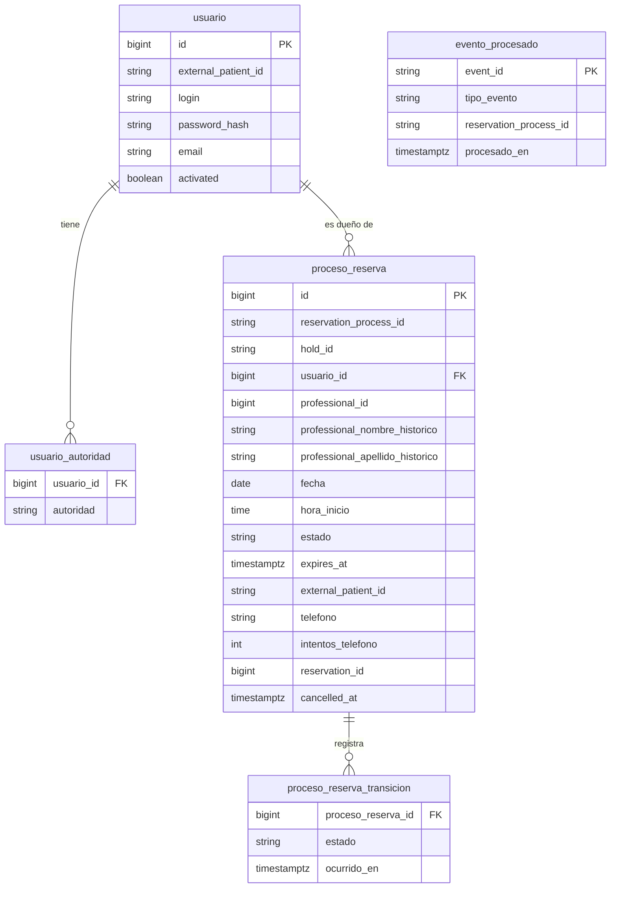

# Contrato entre servicios y modelo de datos

Documento de entrega (#43, enunciado §12): qué consume este servicio del de
catálogo, qué expone a la app KMP, cómo se autentica cada integración y cómo
está modelada la base propia (`turnos_reservas`). El contrato con la
**cátedra** no se repite aquí: esa es `docs/catedra/INTEGRATION_REFERENCE-v2.md`,
que ya es la fuente de verdad y no se duplica.

## 1. Lo que este servicio consume del catálogo

Una sola operación, a través de `CatalogoClient`
(`config/catalogo/CatalogoClient.java`):

| | |
|---|---|
| Operación | `GET /api/internal/professionals/{professionalId}/agenda` |
| Para qué | Profesional vigente + horarios semanales habilitados + versión del catálogo aplicada, en una sola llamada. Es la base de la disponibilidad (M9) y de la validación al crear un hold (M10). |
| Contrato completo | `docs/contratos/catalogo-turnos.md` del repo `turnos-catalogo-sync` (issues `#18`/`#20` de ese repo). |
| Autenticación | JWT técnico interno, emitido por este mismo servicio (`InternalJwtIssuer`, ver §3). |
| Idempotencia | Es un `GET`: reintentable sin efectos secundarios. |

### DTO de respuesta

```
AgendaProfesionalResponse
├─ professional: ProfesionalVigente        { id, categoryId, firstName, lastName, enabled }
├─ schedules: List<HorarioSemanalVigente>  { id, dayOfWeek, startTime, endTime, slotDurationMinutes }
└─ catalogVersion: VersionCatalogoAplicada { version, appliedAt, source }
```

- `schedules` solo trae los horarios **habilitados**, ordenados por día de la
  semana y hora de inicio: ese orden es parte del contrato, no un detalle de
  implementación.
- Nada de esta respuesta se persiste como catálogo vigente. `professional`
  puede quedar como dato **histórico congelado** dentro de un
  `proceso_reserva` (ver §5), nunca como fuente para validar una operación
  nueva.

### Errores

| `code` del `problem+json` | HTTP | Qué significa | Cómo lo maneja este servicio |
|---|---|---|---|
| `AUTH_TOKEN_MISSING` / `AUTH_TOKEN_INVALID` / `AUTH_FORBIDDEN` | 401/403 | El JWT interno es inválido o falta. | No se reintenta: es un error propio de configuración, no transitorio. |
| `PROFESSIONAL_NOT_FOUND` | 404 | El id no existe en el catálogo. | No se reintenta: dato inválido, nada que esperar. |
| `PROFESSIONAL_DISABLED` | 409 | El profesional existe pero está deshabilitado. | No se reintenta. Distinto de "no encontrado" a propósito: impide iniciar una operación nueva pero no invalida una reserva histórica ya hecha con esos datos. |
| *(cualquier 5xx, o error de red)* | 5xx / — | El catálogo no respondió. | Se reintenta con backoff exponencial hasta `catalogo.api.max-retries`; agotados los reintentos se envuelve en `CatalogoNoDisponibleException` → `503 CATALOGO_NO_DISPONIBLE` hacia quien llamó a este servicio. |

Un `code` ausente o no reconocido cae en `CatalogoErrorCode.DESCONOCIDO`: el
cliente sigue funcionando, solo que sin traducción específica (se loguea para
poder ampliar el enum si la cátedra agrega casos nuevos).

## 2. Lo que este servicio expone a la app KMP

OpenAPI generado y publicado por `springdoc` (activable con
`SPRINGDOC_ENABLED`): `/v3/api-docs` (JSON) y `/swagger-ui.html` (interactivo)
son la referencia completa, parámetro por parámetro — esta tabla es el mapa
para orientarse, no la sustituye.

| Método | Ruta | Auth | Para qué |
|---|---|---|---|
| `POST` | `/api/register` | Pública | Alta de un usuario final. |
| `POST` | `/api/authenticate` | Pública | Login; devuelve el JWT de usuario. |
| `GET` | `/api/disponibilidad` | JWT usuario | Slots libres de un profesional en una fecha (catálogo − ocupaciones). |
| `POST` | `/api/holds` | JWT usuario | Crea el hold temporal de un slot. |
| `POST` | `/api/holds/{holdId}/confirm` | JWT usuario | Confirmación inicial (nombre y apellido); dispara el paso por Kafka. |
| `POST` | `/api/holds/{holdId}/phone` | JWT usuario | Envía el teléfono pedido por `AdditionalInformationRequested`. |
| `GET` | `/api/holds/{holdId}` | JWT usuario | Consulta el estado de un proceso de reserva propio. |
| `GET` | `/api/reservas` | JWT usuario | Lista las reservas propias del usuario autenticado. |
| `POST` | `/api/reservas/{reservationProcessId}/cancel` | JWT usuario | Cancela una reserva confirmada propia. |
| `GET` | `/api/health` | Pública (infraestructura, no negocio) | Estado del servicio y de sus dependencias. |

Toda ruta `JWT usuario` filtra siempre por el usuario autenticado del token
(nunca por un id que llegue en el *body* o en un parámetro): es la base del
aislamiento entre usuarios (§7 de `CLAUDE.md`).

## 3. Autenticación entre servicios: formato de los JWT propios

Dos credenciales con secretos **distintos** (`JwtProperties`, que rechaza el
arranque si `JWT_USER_SECRET` y `JWT_INTERNAL_SECRET` coinciden), las dos HS256
con [jjwt](https://github.com/jwtk/jjwt):

### JWT de usuario (`JwtIssuerAdapter`)

Contrato con el servicio de catálogo (ADR 0002 de `turnos-catalogo-sync#59`):
cambiar esto rompe su validación sin coordinar.

| Claim | Valor | Por qué |
|---|---|---|
| `sub` | `login` del usuario | Igual que JHipster (subject = username). **No** es el `externalPatientId`: ese es para la cátedra, no para que lo lea el catálogo. |
| `auth` | Autoridades, como **arreglo** | El catálogo configura `JwtGrantedAuthoritiesConverter` con `setAuthoritiesClaimName("auth")`; un arreglo evita depender de cómo ese converter separaría un string. |
| `iss` | `turnos.jwt.issuer` (`JWT_ISSUER`) | El catálogo lo valida contra su propio `JWT_USER_ISSUER`; mismo default (`turnos-reservas-service`) en los dos repos. |
| `iat` / `exp` | Emisión / vigencia `JWT_USER_EXPIRATION` (default `PT1H`) | — |

Nunca lleva email, `externalPatientId` ni ningún dato de la cuenta técnica de
la cátedra.

### JWT técnico interno (`InternalJwtIssuer`)

Contrato con `SecurityConfig` del catálogo (cadena `apiInterna`, D4 del ADR
0002). Se emite **uno por llamada**, sin caché: con una vigencia de minutos no
vale la pena la complejidad de invalidar antes del vencimiento.

| Claim | Valor | Por qué |
|---|---|---|
| `sub` | `"turnos-reservas-service"` | Identifica al servicio llamante, no a un usuario. |
| `authorities` | `["SERVICE_TURNOS"]` | Nombre de claim distinto de `auth` (el del usuario) a propósito, y **sin** prefijo `ROLE_`: es la identidad de un servicio, no un rol. |
| `iss` | `turnos.jwt.issuer` | Debe coincidir con el `JWT_INTERNAL_ISSUER` que valida el catálogo. |
| `iat` / `exp` | Emisión / vigencia `JWT_INTERNAL_EXPIRATION` (default `PT2M`) | Vigencia corta porque se reemite en cada llamada. |

El JWT técnico **de la cátedra** (`CATEDRA_JWT`) es una tercera credencial,
ajena a estas dos: solo sale hacia el servicio central, nunca se acepta como
entrada ni se reenvía a KMP o al catálogo (detalle completo en #44).

## 4. Modelo de datos propio

Todas las tablas viven en la base lógica `turnos_reservas`, propiedad
exclusiva de este servicio (ver §5). Diagrama de relaciones:



`evento_procesado` no tiene relación declarada con `proceso_reserva`: guarda
`reservation_process_id` como dato plano (no FK) porque es un registro de
deduplicación inmutable, no parte del agregado del proceso.

| Tabla | Para qué sirve | Migración |
|---|---|---|
| `usuario` | Usuarios finales de la app KMP: login, hash Argon2id, `external_patient_id` (el identificador opaco que se envía a la cátedra). Propiedad exclusiva de este servicio (ADR 0002 D1). | V2 |
| `usuario_autoridad` | Autoridades del usuario (`ROLE_USER`). Colección simple, no un catálogo de roles propio. | V2 |
| `evento_procesado` | Deduplicación por `eventId` de los eventos de Kafka: un `event_id` ya presente significa que ya se procesó, `event_id` es la propia `PRIMARY KEY` para que la concurrencia falle en el `INSERT`, no en una lectura previa. | V3 |
| `proceso_reserva` | La unidad de trabajo local (#26): correlaciona REST (hold, confirmación) con Kafka (info adicional, resultado final), con su máquina de estados y todo lo necesario para sobrevivir a un reinicio (`reservation_process_id`, `hold_id`, `expires_at`, `external_patient_id`, teléfono, intentos, resultado, cancelación). No existe una tabla `reserva` separada: una reserva confirmada **es** un `proceso_reserva` en estado final con `reservation_id` completo. | V4, V5, V6, V7, V9, V10, V11 |
| `proceso_reserva_transicion` | Historial de a qué estado pasó cada proceso y cuándo (§7 del enunciado: "los instantes de cada transición"). Una fila por transición, nunca se actualiza. | V4 |

### Columnas descriptivas históricas (no catálogo vigente)

`professional_nombre_historico` y `professional_apellido_historico` en
`proceso_reserva` son el nombre y apellido del profesional **según el
catálogo al momento de crear el hold**. Son datos congelados de ese proceso
puntual:

- se escriben una sola vez, al crear el hold, copiando la respuesta de
  `obtenerAgendaVigente` de ese instante;
- nunca se vuelven a leer para validar una operación nueva ni para resolver
  una búsqueda — eso siempre va de nuevo a `CatalogoClient`;
- si el profesional cambia de nombre o se deshabilita después, las reservas
  ya hechas conservan el dato de cuando se reservaron, que es justamente la
  razón de tenerlas: no sería razonable que el historial de una reserva
  pasada cambiara retroactivamente.

Esto no contradice la prohibición de "no replicar el catálogo" (§4.2 del
enunciado): una copia prohibida es la que se usa como fuente para decidir
sobre operaciones nuevas; un dato histórico dentro de un registro propio que
nunca se usa para eso no lo es.

## 5. Propiedad y separación de datos

| | `turnos_reservas` (este servicio) | `catalogo` (el otro servicio) |
|---|---|---|
| Usuarios finales, login, password | ✅ Propietario único | ❌ No tiene usuarios ni login |
| Procesos de reserva y su estado | ✅ Propietario único | ❌ |
| Reservas confirmadas | ✅ Propietario único | ❌ |
| Eventos de Kafka procesados (dedupe) | ✅ Propietario único | ❌ |
| Categorías, profesionales, horarios semanales | ❌ Nunca se replica | ✅ Propietario único |

Separación impuesta por la base, no por convención: aunque los dos backends
comparten una única **instancia** de PostgreSQL (permitido por el enunciado
§3 bajo esa condición), cada uno tiene su **base lógica** y su **rol**, con
`REVOKE ALL ... FROM PUBLIC` sobre la base y el esquema (detalle en el README,
"Base de datos: una instancia, dos bases lógicas"). Ningún servicio tiene
credenciales para conectarse a la base del otro: la única forma de
integración es el contrato REST de este documento, protegido con el JWT
técnico interno de §3 — nunca una tabla, un esquema o una base compartida.

## Referencias

- Contrato con la cátedra: `docs/catedra/INTEGRATION_REFERENCE-v2.md`.
- Contrato de la agenda vigente con el catálogo:
  `docs/contratos/catalogo-turnos.md` (repo `turnos-catalogo-sync`).
- Identidad y autenticación entre servicios: ADR 0002
  (`manudiiez-um-programacion/turnos-catalogo-sync#59`), replicado para este
  repo en el ADR correspondiente (#45).
- Idempotencia, recuperación y el resto de las decisiones de seguridad: #44.
