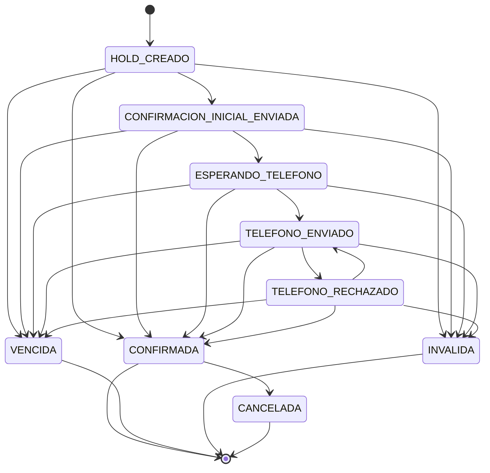

# Idempotencia, recuperación y decisiones de seguridad

Documento de entrega (#44, enunciado §12): es la parte que se defiende
oralmente. No alcanza con que el código funcione: acá está el *por qué* de
cada decisión de robustez y de seguridad, con sus límites conocidos.

## 1. Idempotencia por `eventId`

Kafka entrega **al menos una vez** (§15.1/§18.1 de la referencia): el mismo
evento puede llegar más de una vez. `eventId` es la clave de idempotencia
funcional, y se resuelve con una sola tabla y una sola transacción:

- `evento_procesado.event_id` es la **`PRIMARY KEY`**, no una columna
  cualquiera con una restricción `UNIQUE` aparte. La diferencia importa ante
  concurrencia real: si dos hilos procesan el mismo `eventId` al mismo
  tiempo, el segundo `INSERT` falla por el conflicto de la propia clave en el
  motor, no por una lectura previa ("¿existe ya?") que la otra transacción
  todavía no ve — eso sería una carrera clásica de *check-then-act*. La
  suite de Testcontainers (#41) lo prueba con dos inserciones concurrentes
  reales: una tiene éxito, la otra se descarta sin lanzar
  (`ReservaPostgresKafkaIT`).
- `ProcesarEventoAccionUseCaseImpl.procesar` es **`@Transactional`**, y el
  intento de registrar el evento (`RegistrarEventoProcesadoPort.intentarRegistrar`)
  ocurre **dentro** de esa misma transacción, antes de aplicar el efecto. Si
  el efecto falla después, la marca de "procesado" se revierte junto con él:
  un reintento no puede ver un evento marcado como procesado que en realidad
  nunca tuvo efecto.
- El oyente de Kafka confirma el *offset* recién cuando el método del caso
  de uso retorna sin lanzar (`AckMode.RECORD`, §16 de la referencia): si el
  proceso se cae entre leer el mensaje y terminar la transacción, Kafka
  vuelve a entregar el mismo registro en el próximo intento, y el flujo de
  arriba garantiza que no se duplique su efecto.
- Dos eventos que **no** se marcan como procesados, porque descartarlos es
  siempre la misma decisión sin importar cuántas veces lleguen: un
  `schemaVersion` distinto de 1, o un `eventType` que `TipoEventoAccion` no
  reconoce (`DESCONOCIDO`). Ninguno de los dos se reintenta: repetirlos no
  los arregla.

## 2. Máquina de estados local

`EstadoProcesoReserva` (#26) modela el proceso de reserva con más
granularidad que los estados remotos de la cátedra (`PHONE_PENDING` /
`CONFIRMED` / `CANCELLED` / `FAILED` en `GET /appointments`): `VENCIDA` e
`INVALIDA` son dos estados locales distintos aunque la cátedra los colapse
a `FAILED`.



Reglas, todas impuestas por `EstadoProcesoReserva.puedeTransicionarA` (una
tabla explícita de transiciones válidas, sin "else" implícito que permita
algo no listado):

- **`CONFIRMADA`, `VENCIDA`, `INVALIDA` y `CANCELADA` son finales** y no
  tienen ninguna transición de salida, con una sola excepción deliberada:
  `CONFIRMADA → CANCELADA` (#34), porque cancelar es una operación *nueva*
  sobre una reserva ya concluida, no una reapertura del proceso de reserva.
- **Los tres resultados finales del proceso (`CONFIRMADA`, `VENCIDA`,
  `INVALIDA`) son alcanzables desde cualquier estado no final**, no solo
  desde el último paso esperado (`TELEFONO_ENVIADO`). Es a propósito: el
  orden entre REST y Kafka no está garantizado, y un `AppointmentConfirmed`
  puede llegar antes de que se haya persistido la respuesta del `confirm` o
  incluso antes del `AdditionalInformationRequested`. Así se converge al
  resultado real sin duplicar la reserva, sin importar qué canal llegó
  primero (cubierto por
  `ReservaEndToEndTest#appointmentConfirmedConvergeAunqueLleguePorKafkaAntesDeLaConfirmacionRest`).
- **Transición rechazada ⇒ excepción**, nunca un *no-op* silencioso:
  `TransicionarProcesoReservaUseCaseImpl` lanza
  `TransicionProcesoReservaInvalidaException` si se intenta una transición
  no listada.
- **Un evento tardío sobre un proceso ya final no lo reabre** (§7 del
  enunciado): `ProcesarEventoAccionUseCaseImpl` chequea `estado.esFinal()`
  antes de aplicar cualquier evento de resultado y lo descarta si ya llegó a
  un estado final, incluida la reconciliación entre esta tarea y un
  `AppointmentProcessExpired` tardío (ver §3). Probado explícitamente en
  `ReservaEndToEndTest#unAdditionalInformationRequestedTardioNoReabreUnProcesoConfirmado`.

## 3. Recuperación ante timeouts, reinicios y vencimientos

### 3.1 Reconciliar antes de reintentar una operación con efectos (#36)

Premisa (§18.4 de la referencia): **un timeout no prueba que la operación
falló**. `ConfirmarHoldUseCaseImpl` y `EnviarTelefonoUseCaseImpl` persisten
el intento (`CONFIRMACION_INICIAL_ENVIADA`, o el teléfono con
`TELEFONO_ENVIADO`) **antes** de llamar a la cátedra, no después — es lo que
deja un identificador (`reservationProcessId`) por el cual reconciliar si la
llamada no vuelve a tiempo.

Ante un timeout o un error de infraestructura al confirmar un hold
(`CatedraServerErrorException` o `ResourceAccessException`, nunca
reintentados a ciegas por `CatedraClient`):

1. se busca el `reservationProcessId` en `GET /api/appointments` filtrado
   por `externalPatientId`. Que esté ahí ya prueba que la cátedra aplicó la
   confirmación (el `confirm` nunca queda a medias de su lado), y alcanza
   para alinear el estado local **sin repetir la llamada**;
2. si todavía no está, se permite **exactamente un reintento acotado**; si
   ese reintento también da timeout, se propaga sin insistir más — nunca un
   ciclo de reintentos sin límite (§18.4: "los reintentos deben ser
   limitados y observables").

`RESERVATION_PROCESS_ALREADY_CONFIRMED` se trata como **éxito idempotente**,
no como un error nuevo: es exactamente el caso que esta reconciliación
previene (un reintento que la cátedra ya había aplicado).

### 3.2 Recuperar procesos pendientes al arrancar (#37)

Al terminar de levantar el contexto (`ApplicationReadyEvent`,
`@Async` para no demorar que el servicio quede disponible):

1. corre primero el cierre de vencidos (§3.3), para no reconciliar un
   proceso que ya debería estar cerrado;
2. de los procesos no finales que quedan, solo
   `CONFIRMACION_INICIAL_ENVIADA` tuvo una llamada con efectos pendiente de
   confirmar antes del reinicio (fue la única persistida *antes* de llamar a
   la cátedra, igual que §3.1): se reconcilia contra
   `GET /api/appointments`. Si la cátedra ya la tiene, se alinea a
   `ESPERANDO_TELEFONO`; si no, o si la cátedra no responde, se deja el
   proceso como está — **nunca se reintenta el `confirm` desde el arranque**,
   para que la recuperación no falle ni se cuelgue por una cátedra caída. Un
   próximo intento del usuario o el cierre periódico de vencidos (§3.3)
   terminan de resolverlo;
3. el resto de los estados no finales (`HOLD_CREADO`, `ESPERANDO_TELEFONO`,
   `TELEFONO_ENVIADO`, `TELEFONO_RECHAZADO`) no tuvo ninguna llamada con
   efectos pendiente, así que sigue esperando sin ninguna acción: un hold
   que el usuario no confirmó todavía, o un proceso que espera un resultado
   que Kafka vuelve a entregar solo porque el *offset* no se confirmó.

Es **idempotente sin necesitar una marca propia**: solo revisa procesos no
finales (`listarNoFinales`), así que uno que esta misma recuperación ya
cerró o alineó no vuelve a aparecer en una corrida siguiente — probado en
`ReservaEndToEndTest#reinicioLosProcesosPendientesQuedanCoherentesYNoDuplicanLaReserva`.

### 3.3 Cerrar holds y procesos vencidos (#38)

Tarea programada (`@Scheduled(fixedDelayString = ...)`, nunca
`fixedRate`/`cron`: con `fixedDelay` Spring espera a que termine una corrida
antes de programar la siguiente, así que nunca se superpone consigo misma
sin necesitar un *lock* propio) que revisa los procesos no finales y cierra
como `VENCIDA` los que ya pasaron su `expiresAt`, con un margen de gracia
para no cerrar por una simple diferencia de reloj con la cátedra (§18.4: "el
reloj que vale es el de ella").

También es idempotente sin marca propia, por el mismo motivo que §3.2: solo
mira procesos no finales. Esa misma razón es lo que hace que esta tarea
**converja** con un `AppointmentProcessExpired` tardío en vez de pisarlo —
`ProcesarEventoAccionUseCaseImpl` descarta ese evento si el proceso ya está
en un estado final (el que esta tarea acaba de aplicar), y ningún camino
retrocede un `VENCIDA` a otro estado.

### 3.4 Convergencia entre REST y Kafka fuera de orden

Resumen de los tres mecanismos de arriba: no hay un único camino "correcto"
que REST y Kafka tengan que respetar en orden. Cualquier combinación
converge al mismo resultado final sin duplicar una reserva ni reabrir un
proceso:

| Escenario | Qué pasa |
|---|---|
| `AppointmentConfirmed` llega antes de que el `confirm` por REST haya terminado | La máquina de estados permite `CONFIRMADA` desde cualquier estado no final (§2); el evento gana y el REST que estaba en vuelo, al volver, encuentra el proceso ya confirmado. |
| El `confirm` por REST tiene éxito pero la respuesta se pierde (timeout del cliente) | El usuario puede reintentar: §3.1 reconcilia contra la cátedra antes de repetir la llamada con efectos. |
| El servicio se reinicia con una confirmación en vuelo | §3.2 reconcilia ese único estado (`CONFIRMACION_INICIAL_ENVIADA`) al arrancar. |
| `AdditionalInformationRequested` llega duplicado, o después de que el usuario ya envió el teléfono | §1 descarta el duplicado por `eventId`; si no es duplicado pero el proceso ya está en `ESPERANDO_TELEFONO`, solo se actualiza el pedido más reciente sin retroceder la transición. |
| `AppointmentProcessExpired` llega después de que el cierre periódico (§3.3) ya cerró el proceso | Se descarta: el proceso ya está en un estado final. |

## 4. Timeouts, backoff y límites de reintentos

Todos son ajuste operativo propio (no datos que entregue la cátedra), así
que los de Kafka y de reintentos de teléfono están fijos en el código, y los
de REST tienen default configurable:

| Qué | Valor | Dónde |
|---|---|---|
| Timeout de conexión a la cátedra / al catálogo | `PT2S` (2 s) | `CATEDRA_API_CONNECT_TIMEOUT` / `CATALOGO_API_CONNECT_TIMEOUT` |
| Timeout de lectura a la cátedra / al catálogo | `PT5S` (5 s) | `CATEDRA_API_READ_TIMEOUT` / `CATALOGO_API_READ_TIMEOUT` |
| Reintentos de un `GET` idempotente (ocupaciones, agenda vigente) ante 5xx/error de red | 3, con backoff exponencial desde `PT0.2S` (0.2 s → 0.4 s → 0.8 s) | `CATEDRA_API_MAX_RETRIES` / `CATALOGO_API_MAX_RETRIES` + `*_RETRY_BACKOFF` |
| Reintento de una operación con efectos (`confirm`) tras reconciliar sin encontrarla | Exactamente **1** | Fijo en `ConfirmarHoldUseCaseImpl` (§3.1) |
| Reintentos de teléfono rechazado | Máximo **3** intentos (`MAX_INTENTOS_TELEFONO`) | Fijo en `EnviarTelefonoUseCaseImpl` |
| Reintentos del oyente de Kafka ante un mensaje que no se puede ni leer (JSON inválido, falta un campo común) | 3 intentos, 500 ms fijos entre cada uno (`FixedBackOff`), después se registra el fallo y se avanza el *offset* | Fijo en `AccionesReservaKafkaConsumerConfig` |
| Margen de gracia antes de considerar vencido un proceso | `PT5S` (5 s) | `TURNOS_VENCIMIENTO_MARGEN` |
| Frecuencia del cierre periódico de vencidos | `PT30S` (30 s) | `TURNOS_VENCIMIENTO_FRECUENCIA` |

Ninguno de estos valores admite un ciclo infinito: cada reintento tiene un
tope explícito y, agotado, el flujo deja el proceso en un estado observable
(una excepción hacia el usuario, o esperando el próximo evento/tarea) en
vez de bloquearse.

## 5. Decisiones de seguridad

### 5.1 Hasheo de contraseñas: Argon2id

Indicación del profesor (28-10-2026): BCrypt quedó debilitado frente al
poder de cómputo actual. Parámetros **explícitos** (no los *defaults*
implícitos de la librería, que podrían cambiar de versión a versión sin que
el código lo refleje), en `PasswordEncoderConfig`:

| Parámetro | Valor | Por qué |
|---|---|---|
| Sal | 16 bytes | — |
| Hash | 32 bytes | — |
| Paralelismo | 1 | — |
| Memoria | 19456 KiB (19 MiB) | Recomendación OWASP 2023 para Argon2id, y el parámetro que más le cuesta forzar a un atacante. |
| Iteraciones | 2 | — |

Son valores de partida de OWASP **medidos**, no copiados a ciegas: en la
máquina de desarrollo un `encode()` tarda 20–25 ms en estado estable y el
hash resultante mide 97 caracteres (105 con el prefijo `{argon2}`), de ahí
que `usuario.password_hash` sea `VARCHAR(120)` y no los 60 fijos de BCrypt.

El `DelegatingPasswordEncoder` antepone el prefijo `{argon2}` al hash
guardado: verificar un login delega según **ese prefijo**, no según el
encoder configurado hoy. Eso deja abierto cambiar de algoritmo o de
parámetros a futuro sin invalidar los hashes existentes — simplemente
conviven dos prefijos hasta que los usuarios antiguos vuelvan a loguearse (y
JHipster sigue el mismo patrón).

### 5.2 JWT de usuario: HS256 con secreto compartido

Formato completo (claims, algoritmo, vigencia) en
`docs/contrato-y-modelo-de-datos.md#3`. La decisión de seguridad relevante
acá es la **limitación aceptada**: con HS256 y un secreto simétrico
(`JWT_USER_SECRET`) que **necesariamente** comparten los dos backends (este
servicio lo usa para firmar, el catálogo para verificar), el servicio de
catálogo es *técnicamente* capaz de **falsificar** un token de usuario, no
solo de verificarlo — HS256 no distingue esos dos poderes, a diferencia de
un esquema asimétrico.

Se acepta (declarado también en el ADR 0002 de `turnos-catalogo-sync#59`)
porque los dos backends son del mismo proyecto, los mantiene la misma
persona y se despliegan juntos: el riesgo que HS256 introduce es el de un
compañero de equipo, no el de un tercero. El camino de mejora, si alguna vez
deja de ser aceptable, es **RS256** con la clave privada solo en este
servicio y la pública en el `.env` del catálogo — un cambio del decodificador
en los dos repos, no del dominio de ninguno de los dos.

### 5.3 JWT técnico interno: identidad de servicio, no de usuario

Segunda credencial, secreto **distinto** del anterior
(`JWT_INTERNAL_SECRET`), con la autoridad `SERVICE_TURNOS` y sin prefijo
`ROLE_` (no es un rol, es la identidad de un servicio). `JwtProperties`
**rechaza el arranque** si los dos secretos coinciden
(`isSecretosDistintos`): copiar el mismo valor en las dos variables de
entorno es el error fácil de cometer armando el `.env`, y deja todo
funcionando en apariencia mientras borra en silencio la frontera entre "un
usuario pidiendo algo" y "un backend pidiendo algo". Con un secreto
compartido, un token de usuario robado se podría presentar como si fuera el
del servicio.

El JWT técnico **de la cátedra** es una tercera credencial, ajena a las dos
de arriba: solo sale hacia el servicio central, nunca se acepta como entrada
ni se reenvía a KMP o al catálogo. Si se filtra, no alcanza con borrarlo de
un commit — hay que rotarlo (crear otra cuenta técnica y reconfigurar los
dos backends).

### 5.4 Aislamiento entre usuarios

Toda ruta de negocio protegida resuelve el usuario desde el **claim `sub`**
del JWT ya validado (`Authentication`), nunca desde un id que llegue en el
*body* o en un parámetro: ni `RegistroRequest` ni `AutenticacionRequest`
exponen un campo para elegir identidad, y ningún otro endpoint acepta un
`externalPatientId` o un id de usuario del cliente
(`ReservaEndToEndTest#ningunEndpointAceptaExternalPatientIdNiUsuarioIdDelCliente`).
Confirmar, enviar el teléfono, consultar o cancelar el proceso de **otro**
usuario falla aunque se conozca su `holdId` o su `reservationProcessId`
(`otroUsuarioNoPuedeConfirmarNiEnviarElTelefonoDeUnProcesoAjeno`,
`autorizacionConsultarElUsuarioNoVeLasReservasDelOtro`,
`autorizacionElUsuarioNoPuedeCancelarLaReservaDelOtro`).

### 5.5 CORS y externalización de secretos

- **CORS**: lista explícita de orígenes permitidos (`CORS_ALLOWED_ORIGINS`),
  nunca `*` — vacía por defecto, que es el default seguro (ningún
  *cross-origin* permitido hasta que se liste un cliente real).
- **Secretos externalizados**: ningún secreto vive en el repositorio. URL de
  la cátedra, JWT técnico, credenciales de Redis (si se usan) y los dos
  secretos de JWT propios se leen de variables de entorno (`.env`, ignorado
  por git; solo se versiona `.env.example`). Las obligatorias sin default
  (`CatedraProperties`, la parte sin default de `JwtProperties`) hacen que
  el servicio **no arranque** si falta una, con un error que nombra
  exactamente cuál. `CatedraProperties` y `JwtProperties` enmascaran en su
  `toString()` el JWT técnico, la password de Redis y los dos secretos de
  JWT, para que un log de depuración o el volcado de un error de *binding*
  no los filtre.
- **Sin sesiones ni CSRF**: la API es `STATELESS` y no usa cookies; la
  protección CSRF existe para mitigar que el navegador adjunte una cookie de
  sesión sola, y acá no hay cookie que adjuntar — el cliente tiene que poner
  el JWT a mano en cada *request*.

## 6. Limitaciones conocidas

- **Secreto HS256 compartido entre los dos backends** (§5.2): el catálogo
  puede falsificar un token de usuario, no solo validarlo. Aceptado por ser
  el mismo proyecto; camino de mejora: RS256.
- **La reconciliación de #36 tiene un solo reintento acotado**: si la
  cátedra sigue sin responder después de reconciliar, la operación falla
  hacia el usuario en lugar de seguir esperando. Es deliberado (nunca
  bloquear indefinidamente), pero significa que una caída prolongada de la
  cátedra se nota como un error visible, no como una espera transparente.
- **El cierre de vencidos corre en un solo nodo lógico**: `fixedDelay` evita
  que se superponga consigo mismo, pero no hay un *lock* distribuido pensado
  para correr más de una instancia de este servicio a la vez. No es un
  problema hoy (una sola instancia), pero escalar horizontalmente este
  componente necesitaría revisar ese punto.
- **`AppointmentProcessInvalid` no reconcilia activamente contra la
  cátedra** (a diferencia de `confirm`/arranque): hoy solo registra el
  motivo que informó la cátedra; una reconciliación activa específica para
  ese evento no está implementada.
- **Sin revocación anticipada de JWT**: ni el de usuario ni el técnico
  interno se pueden invalidar antes de su vencimiento natural. Vigencias
  cortas (una hora el de usuario, dos minutos el interno) acotan la
  ventana en lugar de eliminarla.
- **El scheduler de vencidos no distingue "cátedra caída" de "proceso
  realmente vencido"**: cierra por `expiresAt` local con margen de reloj,
  sin confirmar contra la cátedra antes de cerrar. Si el reloj local se
  desincroniza más allá del margen configurado, podría cerrar un proceso
  que la cátedra todavía considera vigente (y viceversa).

## 7. Cómo correr las pruebas automatizadas

```bash
./mvnw verify          # unitarias + integracion con dobles (rapido, sin Docker)
./mvnw verify -Pe2e     # + la suite de Testcontainers (#41), requiere Docker
```

Qué comportamiento obligatorio (§8 del enunciado) cubre cada grupo:

| Comportamiento exigido | Dónde se prueba |
|---|---|
| **Registro y autenticación** | `AuthSecurityIntegrationTest` (alta, hash Argon2id distinto por alta, login duplicado, credenciales incorrectas sin distinguir si el login existe) + unitarias de `auth/application` e infraestructura. |
| **Autorización** (aislamiento entre usuarios) | `AuthSecurityIntegrationTest` ("aislamiento entre usuarios") y, de punta a punta, `ReservaEndToEndTest` (`otroUsuarioNoPuedeConfirmarNiEnviarElTelefonoDeUnProcesoAjeno`, `autorizacionConsultarElUsuarioNoVeLasReservasDelOtro`, `autorizacionElUsuarioNoPuedeCancelarLaReservaDelOtro`, `ningunEndpointAceptaExternalPatientIdNiUsuarioIdDelCliente`). |
| **Idempotencia** | `ReservaEndToEndTest` (`reenviarElMismoAppointmentConfirmedNoCambiaElResultado`, `duplicadosReenviarElMismoAppointmentCancelledNoCambiaElEstado`, `idempotenciaCancelarDosVecesPorRestDejaElMismoEstadoFinal`) + `ProcesarEventoAccionUseCaseImplTest` + `EventoProcesadoRepositoryAdapterTest`. Contra una base real, con concurrencia de verdad: `ReservaPostgresKafkaIT#dosInsercionesConcurrentesDelMismoEventIdSoloUnaTieneExito`. |
| **Reconciliación / recuperación / vencimientos** | `ReservaEndToEndTest` (`reinicioLosProcesosPendientesQuedanCoherentesYNoDuplicanLaReserva`, `vencimientoUnProcesoCerradoPorElCierrePeriodicoRechazaConfirmacionesPosteriores`, `appointmentProcessExpiredCierraElProcesoYCortaNuevosIntentos`, `unAdditionalInformationRequestedTardioNoReabreUnProcesoConfirmado`) + `RecuperarProcesosPendientesUseCaseImplTest`, `CerrarProcesosVencidosUseCaseImplTest`, `RecuperacionArranqueListenerTest`, `CierreVencidosSchedulerTest`. |
| **Sincronización / flujo completo** | `ReservaEndToEndTest#caminoFelizCompletoConfirmaLaReservaConElReservationId` (hold → confirmación → teléfono → `AppointmentConfirmed`, con dobles) y `ReservaPostgresKafkaIT#flujoDeReservaCompletoDePuntaAPuntaConPostgresYKafkaReales` (el mismo flujo contra PostgreSQL y Kafka reales). |

Los dos *end-to-end* (`ReservaEndToEndTest`, con dobles; `ReservaPostgresKafkaIT`,
con Testcontainers) simulan la cátedra y el catálogo con el mismo servidor
HTTP en memoria: no hace falta ningún secreto real para correr ninguna de
las dos.

## Referencias

- Contrato entre servicios y modelo de datos: #43,
  `docs/contrato-y-modelo-de-datos.md`.
- ADR de las decisiones de diseño (motor de base, arquitectura, identidad,
  Argon2id, máquina de estados, deduplicación): #45.
- Detalle operativo de cómo y cuándo corre la suite de Testcontainers (perfil
  Maven `e2e`, requisitos de Docker, qué corre en CI): README, sección
  "Pruebas".
